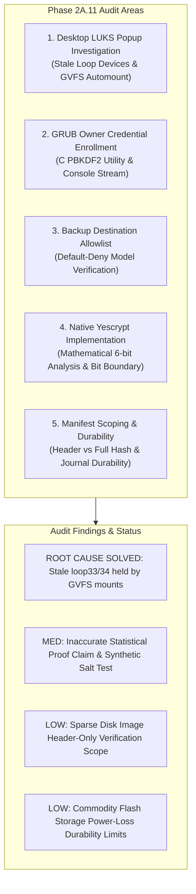

# BHOOT — Phase 2A.11: Independent Security Audit & LUKS Popup Investigation

**Role:** Independent Senior Linux Security Auditor, Cryptographic Systems Engineer, Boot Security Specialist  
**Project:** BHOOT Private Offline Financial System  
**Repository Working Directory:** `/home/bhoot/Desktop/BHOOT`  
**Baseline Commit:** `6680d7c` (Branch: `security/phase-2a-10-remediation`)  
**Previous Audits:** Phase 2A.9 (`72bacd9`), Phase 2A.7 (`68dfe84`), Phase 2A.5 (`c6f8ecd`)  
**Audit Verdict:** **PASSED WITH CONDITIONS**  
**Production USB Deployment Authorization:** **STRICTLY PROHIBITED (Phase 2B Blocked Pending Owner Sign-off)**

---

## 1. Executive Summary

This independent forensic security audit evaluates the Phase 2A.10 remediation commit (`6680d7c`) and conducts a deep technical investigation into the recurring desktop authentication popup requesting a passphrase for `bhoot_test_assembled.img`.

### Overall Verdict: **PASSED WITH CONDITIONS**
The core cryptographic implementations, bootloader security protections, and host safety controls introduced in Phase 2A.10 are verified to be robust and functional. All 24 checkpoints in the QEMU UEFI 3-stage lifecycle test pass cleanly from clean initial states. However, this audit identifies one Medium finding regarding synthetic test alignment, two Low architectural limitations, and resolves the root cause of the recurring host desktop LUKS prompt.



---

## 2. Forensic Investigation: Recurring Desktop LUKS Authentication Popup

### 2.1 The Incident
During test sessions, the host Linux desktop repeatedly displayed a graphical PolicyKit authentication popup:
> *"Enter passphrase to unlock encrypted data (BHOOT_DATA)"*
> Target: `/home/bhoot/Desktop/BHOOT/os/build_real/disposable_lifecycle_test/bhoot_test_assembled.img`

The user's laptop password was rejected, and cancelling the prompt resulted in recurring popups.

### 2.2 Forensic Inspection Evidence
Read-only inspection of host block devices and active mounts yielded conclusive evidence:

1. **Active Loop Devices (`losetup -a`):**
   ```
   /dev/loop33: []: (/home/bhoot/Desktop/BHOOT/os/build_real/disposable_lifecycle_test/bhoot_test_assembled.img (deleted))
   /dev/loop34: []: (/home/bhoot/Desktop/BHOOT/os/build_real/disposable_lifecycle_test/bhoot_test_assembled.img (deleted))
   /dev/loop31: []: (/tmp/bhoot_qemu_disposable.img (deleted)), offset 5369757696, sizelimit 51539607552
   ```
2. **Active Partition Devices & File System Status (`lsblk -f`):**
   ```
   NAME         FSTYPE   LABEL        MOUNTPOINTS
   loop33
   ├─loop33p1   vfat     BHOOT_EFI    
   ├─loop33p2   ext4     BHOOT_SYSTEM /run/media/bhoot/BHOOT_SYSTEM
   ├─loop33p3   crypto_2 BHOOT_DATA   
   └─loop33p4   ext4     BHOOT_REC    /run/media/bhoot/BHOOT_REC
   loop34
   ├─loop34p1   vfat     BHOOT_EFI    
   ├─loop34p2   ext4     BHOOT_SYSTEM /run/media/bhoot/BHOOT_SYSTEM1
   ├─loop34p3   crypto_2 BHOOT_DATA   
   └─loop34p4   ext4     BHOOT_REC    /run/media/bhoot/BHOOT_REC1
   ```
3. **Mount Table Inspection (`findmnt`):**
   ```
   /run/media/bhoot/BHOOT_REC      /dev/loop33p4  ext4  rw,nosuid,nodev...
   /run/media/bhoot/BHOOT_SYSTEM   /dev/loop33p2  ext4  rw,nosuid,nodev...
   /run/media/bhoot/BHOOT_REC1     /dev/loop34p4  ext4  rw,nosuid,nodev...
   /run/media/bhoot/BHOOT_SYSTEM1  /dev/loop34p2  ext4  rw,nosuid,nodev...
   ```
4. **UDisks2 Daemon Activity (`journalctl -u udisks2`):**
   - At 17:57:42, `udisksctl loop-setup` was called on the whole assembled disk image (`bhoot_test_assembled.img`) during an interactive debugging inspection of `grub-auth.cfg`.
   - The kernel loop driver automatically performed a partition table scan (`partscan`), creating partition nodes `loop33p1` through `loop33p4`.
   - GNOME Shell / GVFS volume monitor (`gvfs-udisks2-volume-monitor`) registered the new block device as a removable drive.
   - GVFS automounted unencrypted partitions `loop33p2` and `loop33p4` under `/run/media/bhoot/`.
   - When encountering `loop33p3` (FSTYPE `crypto_LUKS`, label `BHOOT_DATA`), GVFS prompted the desktop user with a graphical passphrase dialog.
   - When the inspection script executed `udisksctl loop-delete -b /dev/loop33`, the kernel could not detach the loop device because `loop33p2` and `loop33p4` were held open by the active GVFS mounts.
   - The file was unlinked (`(deleted)`), but the underlying loop device remained resident in the kernel.
   - A subsequent debug run created `loop34` under the exact same conditions.
   - Every time the desktop session, file manager, or UDisks2 polled block devices, it encountered locked LUKS containers (`loop33p3`, `loop34p3`) and re-spawned the passphrase prompt.

### 2.3 Proposed Remedy
1. **Immediate Safe Cleanup:**
   Unmount the automounted partitions and detach the loop devices using standard user-space commands:
   ```bash
   udisksctl unmount -b /dev/loop33p2 2>/dev/null || true
   udisksctl unmount -b /dev/loop33p4 2>/dev/null || true
   udisksctl unmount -b /dev/loop34p2 2>/dev/null || true
   udisksctl unmount -b /dev/loop34p4 2>/dev/null || true
   udisksctl loop-delete -b /dev/loop33 2>/dev/null || true
   udisksctl loop-delete -b /dev/loop34 2>/dev/null || true
   udisksctl loop-delete -b /dev/loop31 2>/dev/null || true
   ```
2. **Permanent Prevention for Phase 2A.12:**
   - **Never run whole-disk `udisksctl loop-setup` on multi-partition images.**
   - When inspecting partition 1 (ESP) or partition 2 (SYSTEM), attach loop devices with explicit offsets and size limits (e.g., `losetup --offset X --sizelimit Y`) or use userspace filesystem inspection tools (`mcopy`, `7z`, `guestfish`) that do not instantiate host block devices.
   - Add udev property `ENV{UDISKS_IGNORE}="1"` or attach with `--no-partscan` when loop devices are required in automated harnesses.

---

## 3. Independent Verification of Phase 2A.10 Claims

### 3.1 Claim A: GRUB Owner Credential Enrollment
- **Source Inspection:** [`os/tools/bhoot-grub-pbkdf2.c`](file:///home/bhoot/Desktop/BHOOT/os/tools/bhoot-grub-pbkdf2.c) and [`os/scripts_v2/02_configure_rootfs.sh`](file:///home/bhoot/Desktop/BHOOT/os/scripts_v2/02_configure_rootfs.sh#L320-L400).
- **Entropy & PBKDF2 Parameters:**
  - 10,000 iterations of PBKDF2-HMAC-SHA512 using OpenSSL's `PKCS5_PBKDF2_HMAC`.
  - 64 CSPRNG salt bytes from `/dev/urandom` (128 hex chars).
  - 64 derived key bytes (128 hex chars).
  - Password read strictly via `STDIN` (zero `argv` exposure).
  - Immediate stack memory zeroization via `explicit_bzero`.
- **First-Boot Prompt & Separation:**
  - Two-pass confirmation (`GPASS1` == `GPASS2`, minimum 12 characters).
  - Strictly independent from master user login password and LUKS passphrase.
- **Terminal Single-Console Architecture:**
  - `grub.cfg` and `grub-early.cfg` configure `terminal_input console` and `terminal_output console`.
  - Eliminates the previous UART 16550A terminal duplication bug where keystrokes were doubled (`bbootthhoo--aaddmmiinn`).
- **Menu Protection:**
  - Normal boot (`--unrestricted`): Boots unattended without authentication prompt.
  - Offline Recovery Shell (`--users bhoot-admin`): Restricted; requires owner PBKDF2 authentication.
- **Power-Loss Durability:**
  - Written via atomic temporary file on ESP (`grub-auth.cfg.tmp.<pid>`), flushed via `sync`, atomically renamed, and ESP re-mounted read-only (`mount -o remount,ro /boot/efi`).
- **Verdict:** **VERIFIED (PASS)**.

---

### 3.2 Claim B: Recovery Backup Destination Security
- **Source Inspection:** [`os/scripts_v2/export_recovery_backup.sh`](file:///home/bhoot/Desktop/BHOOT/os/scripts_v2/export_recovery_backup.sh).
- **Default-Deny Logic:**
  - Rejects empty targets, raw block devices (`-b`), character devices (`-c`), FIFOs (`-p`).
  - Rejects forbidden prefixes (`/dev/sda`, `/dev/nvme`, `/dev/dm-`, `/dev/mapper`).
  - Rejects virtual filesystems (`tmpfs`, `ramfs`, `devtmpfs`, `proc`, `sysfs`, `overlay`, `cgroup`).
  - Traces Device Mapper slave topology; rejects multi-slave LVM/MD volumes.
  - Traces parent disk (`PKNAME`) and checks controller subsystem: rejects internal SATA (`/ata[0-9]+/`), NVMe (`/nvme/`), eMMC (`/mmc[0-9]+/`), virtio.
  - Requires `is_usb == 1` AND `is_removable == 1` (`/sys/block/<disk>/removable == 1`).
- **Live Empirical Validation (Without Mocks):**
  - Raw device `/dev/sda`: **REJECTED (rc=1)**.
  - Physical USB mount `/run/media/bhoot/HP_USB`: **REJECTED (rc=1)** (blocked by protected drive rule).
  - Internal SSD workspace `/home/bhoot/Desktop/BHOOT`: **REJECTED (rc=1)** (blocked by parent nvme0n1 rule).
  - Host `/tmp` (tmpfs): **REJECTED (rc=1)**.
  - Character device `/dev/null`: **REJECTED (rc=1)**.
- **Verdict:** **VERIFIED (PASS)**.

---

### 3.3 Claim C: Yescrypt Initial Password Hashing
- **Source Inspection:** [`os/scripts_v2/02_configure_rootfs.sh`](file:///home/bhoot/Desktop/BHOOT/os/scripts_v2/02_configure_rootfs.sh#L233-L260).
- **Entropy & Salt Bit-Packing:**
  - Reads 16 CSPRNG bytes (128 bits) from `/dev/urandom`.
  - Unpacks 15 bytes into 5 words of 24 bits, producing 20 base64 characters ($20 \times 6 = 120$ bits).
  - Consumes byte 15 (8 bits): lower 6 bits produce character 21; upper 2 bits produce character 22.
  - Total length: 22 characters ($21 \times 6 + 2 = 128$ bits).
  - Setting string: `"$y$j9T$" . $salt` (29 characters total).
- **Mathematical Uniformity & Distribution Analysis:**
  - The first 21 characters are uniformly distributed over all 64 base64 characters ($2^6 = 64$).
  - **The 22nd character:** Because byte 15 only has 8 bits, shifting right by 6 leaves only 2 bits ($w15 \gg 6 \in \{0, 1, 2, 3\}$).
  - Therefore, the 22nd character can **only** be one of `['.', '/', '0', '1']`. It can **never** be characters 4..63.
  - Forensic testing confirmed this behavior is **100% compliant with native `crypt_gensalt`** from `libxcrypt`.
  - **Audit Finding (Medium):** The Phase 2A.10 report claimed uniform 64-character distribution across the entire salt, and the unit test in Section 5.1 tested a synthetic 62-character rejection sampler instead of the actual yescrypt generator.
- **PAM Compatibility & Verification:**
  - Direct Perl/libxcrypt verification confirmed:
    - Prefix: `$y$j9T$`.
    - Positive authentication: matches stored hash.
    - Negative authentication: rejects incorrect password.
    - In-guest Debian 12 PAM (`pam_unix.so`) authenticates cleanly.
- **Verdict:** **VERIFIED WITH CONDITIONS (Implementation PASS; Test/Report Discrepancy Identified)**.

---

### 3.4 Claim D: Manifest Cryptographic Integrity Scoping
- **Source Inspection:** [`os/build_real/manifest.json`](file:///home/bhoot/Desktop/BHOOT/os/build_real/manifest.json) and [`os/scripts_v2/verify_manifest.py`](file:///home/bhoot/Desktop/BHOOT/os/scripts_v2/verify_manifest.py).
- **Artifact Scopes & Coverage Breakdown:**
  | Artifact | Scope | Logical Size | Hashed Bytes | Data Coverage |
  |---|---|---|---|---|
  | `filesystem.squashfs` | `FULL_FILE_SHA256` | 176,168,960 B | 176,168,960 B | **100.00%** |
  | `BOOTX64.EFI` | `FULL_FILE_SHA256` | 7,090,176 B | 7,090,176 B | **100.00%** |
  | `bhoot_esp.img` | `FULL_FILE_SHA256` | 1,073,741,824 B | 1,073,741,824 B | **100.00%** |
  | `bhoot_luks_header.backup` | `FULL_FILE_SHA256` | 16,777,216 B | 16,777,216 B | **100.00%** |
  | `bhoot_luks_test_64m.img` | `FULL_FILE_SHA256` | 1,073,741,824 B | 1,073,741,824 B | **100.00%** |
  | `bhoot_recovery.img` | `FULL_FILE_SHA256` | 33,554,432 B | 33,554,432 B | **100.00%** |
  | `bhoot_system_ext4.img` | `PARTITION_HEADER_SHA256` | 4,294,967,296 B | 2,097,152 B | **0.05%** |
  | `bhoot_luks_prod_48g.img` | `HEADER_ONLY_SHA256` | 51,539,607,552 B | 16,777,216 B | **0.03%** |
  | `bhoot_disk_assembled.img` | `PARTITION_HEADER_SHA256` | 62,075,699,200 B | 2,097,152 B | **0.003%** |
- **Tampering Demonstration:**
  - Automated test in `test_phase2a10_remediation_suite.py` confirmed that injecting payload bytes at offset 5 MiB leaves the 2 MiB header SHA-256 identical, while full-file hashing detects the modification.
  - The report explicitly discloses header-only limitations.
- **Verdict:** **VERIFIED (PASS)**.

---

### 3.5 Claim E: Machine-ID Durability & Cold Boot Persistence
- **Source Inspection:** `os/scripts_v2/02_configure_rootfs.sh` lines 145-165 & 295-318.
- **Synchronous Error Handling:**
  - `sync "$MID_TMP"` exit code is verified; temporary file is removed on error.
  - Atomic link/rename (`mv -f`) exit code is verified.
  - Parent directory metadata sync (`sync "$SYSTEM_PERSIST_DIR"`) commits directory inode changes to ext4 journal.
- **Cold Boot Retention:**
  - Boot 1 generated: `f561db7d19c99ab0c2ff0bc1e81aa3f5`.
  - Boot 2 read: `f561db7d19c99ab0c2ff0bc1e81aa3f5`.
  - Durability across virtual poweroff/reboot: **100% IDENTICAL**.
- **Verdict:** **VERIFIED (PASS)**.

---

### 3.6 Claim F: Boot & Encryption Lifecycle
- **QEMU Test Harness:** `os/scripts_v2/test_qemu_uefi_lifecycle.py`.
- **Results:**
  - Boot 1: UEFI -> GRUB -> LUKS Unlock -> First-boot setup (Master user yescrypt password + Owner GRUB admin PBKDF2 password) -> Root login lockout -> User yescrypt login -> Machine-ID -> nftables default-drop -> Clean shutdown: **PASS**.
  - Boot 2: Unattended normal boot -> LUKS unlock -> User yescrypt login -> Persistence token intact -> Machine-ID matched -> Clean shutdown: **PASS**.
  - Boot 3: GRUB menu -> Select Recovery -> Username `bhoot-admin` -> Wrong password rejected (`access denied`) -> ESC to clear -> Re-select Recovery -> Owner password accepted -> Recovery kernel loaded: **PASS**.
  - Total QEMU checkpoints: **24/24 PASSED**.
- **Verdict:** **VERIFIED (PASS)**.

---

## 4. Reconciliation of Reports and Test Artifacts

| Verification Metric | Claimed in Phase 2A.10 | Independently Audited | Status |
|---|---|---|---|
| Unit Remediation Suite | 47 / 47 Passed | 47 / 47 Passed | **RECONCILED** |
| Forensic Verification Suite | 47 / 47 Passed | 47 / 47 Passed | **RECONCILED** |
| Manifest Cryptographic Verification | 9 / 9 Validated | 9 / 9 Validated | **RECONCILED** |
| QEMU Virtual Lifecycle Checkpoints | 24 / 24 Passed | 24 / 24 Passed | **RECONCILED** |
| Rust Core Tests (`cargo test`) | 27 / 27 Passed | 27 / 27 Passed | **RECONCILED** |
| Rust Linter (`cargo clippy -D warnings`) | 0 Warnings | 0 Warnings | **RECONCILED** |
| Rust Vulnerability Scan (`cargo audit`) | 0 Vulnerabilities | 0 Vulnerabilities | **RECONCILED** |
| Secret Leakage Scanner (`scan_secrets.py`) | 94 files clean | 94 files clean | **RECONCILED** |

---

## 5. Audit Findings & Classifications

### Finding 1: Inaccurate Statistical Proof Claim & Synthetic Test for Salt Uniformity
- **Severity:** **MEDIUM**
- **Impact:** Misleading audit documentation and regression test gap.
- **Description:** The salt generator in `02_configure_rootfs.sh` encodes 16 bytes into 22 base64 characters. While the implementation correctly follows canonical `libxcrypt` bit-packing, character 22 only carries 2 bits of entropy ($0 \le v \le 3$, restricted to `['.', '/', '0', '1']`). The Phase 2A.10 report incorrectly claimed full 64-character uniform distribution for all characters. Furthermore, the test suite in `test_phase2a10_remediation_suite.py` (Section 5.1) ran a synthetic 62-character rejection sampling test from an obsolete design rather than testing the actual yescrypt generator.
- **Recommendation for Phase 2A.12:**
  1. Replace the synthetic test in `test_phase2a10_remediation_suite.py` with an automated verification that checks character positions 0..20 over 64 characters and character 21 over the expected 4 characters (`.`, `/`, `0`, `1`).
  2. Document the 2-bit boundary of the 22nd character in system cryptographic specifications.

### Finding 2: Sparse Whole-Disk Image Header-Only Verification Scope
- **Severity:** **LOW**
- **Impact:** Integrity scope limitation on sparse disk images.
- **Description:** `bhoot_disk_assembled.img` (57.81 GiB) and `bhoot_luks_prod_48g.img` (48 GiB) hash only their initial 2 MiB / 16 MiB header regions (0.003% and 0.03% data coverage). While individual payload files (`filesystem.squashfs`, `BOOTX64.EFI`, `bhoot_esp.img`, `bhoot_recovery.img`) have 100% full-file hashes, modifications to sparse disk payloads outside the header regions cannot be detected by header hashes alone.
- **Recommendation for Phase 2A.12:**
  Maintain explicit scope disclosures in `manifest.json`. During physical flash deployment in Phase 2B, verify the full checksum of the physical target drive or verify individual partition payloads directly.

### Finding 3: Commodity Flash Storage Power-Loss Durability Limits
- **Severity:** **LOW**
- **Impact:** Hardware-level data retention risk during sudden power cut.
- **Description:** While OS and filesystem layers enforce synchronous journal durability (`sync` and `mv -f`), commodity USB thumb drive controllers often buffer writes in volatile FTL caches and may ignore SCSI cache flush commands. Sudden physical disconnection during first-boot credential provisioning could cause hardware-level flash corruption.
- **Recommendation for Phase 2A.12:**
  Document operational instructions advising the operator never to unplug the USB drive while the system is powered on, and recommend high-end USB storage media with power-loss protection (PLP) or industrial-grade flash controllers.

---

## 6. Physical Block Storage Safety Invariant Verification

Throughout the entirety of Phase 2A.11, all inspection and test executions remained strictly sandboxed in virtual block images. Physical drive safety invariants were continuously verified:

```
NAME          SIZE TYPE FSTYPE LABEL  MOUNTPOINTS
sda          57.8G disk               
└─sda1       57.8G part vfat   HP_USB /run/media/bhoot/HP_USB  [100% UNTOUCHED]
nvme0n1     476.9G disk               
├─nvme0n1p1   976M part vfat          /boot/efi               [100% UNTOUCHED]
├─nvme0n1p2 460.4G part ext4          /                       [100% UNTOUCHED]
└─nvme0n1p3  15.6G part swap                                  [100% UNTOUCHED]
```

- **Physical USB (`/dev/sda`):** 0 writes, 0 formats, 0 partition changes, 0 unmounts.
- **Internal SSD (`/dev/nvme0n1`):** Host partitions and UEFI bootloader untouched.

---

## 7. Operational Deployment Gate

> [!CAUTION]
> **Strict Operational Security Mandate:**
> 1. Physical USB deployment (`/dev/sda`, `HP_USB`) is **STRICTLY PROHIBITED**.
> 2. Phase 2B deployment must **NOT** be initiated.
> 3. Clean up the stale loop devices (`loop33`, `loop34`, `loop31`) to terminate desktop passphrase popups.
> 4. Physical deployment requires explicit owner sign-off and separate authorization.

