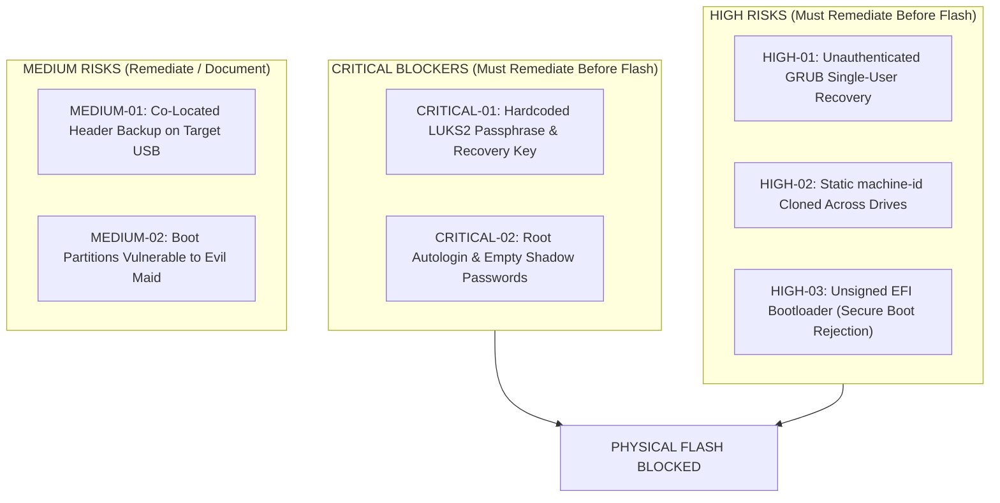

# PROJECT BHOOT — Phase 2A.5: Pre-Deployment Security Readiness Audit

**Role:** Senior Linux Security Engineer, Boot Security Auditor, and Storage Security Specialist  
**Date of Audit:** 2026-11-06  
**Project Workspace:** `/home/bhoot/Desktop/BHOOT`  
**Target Git Baseline:** Commit `c6f8ecd` on branch `feature/phase-2a-4-virtual-boot`  
**Target Hardware Platform:** Dell Latitude 5410 (Intel Core i7-10610U, 16 GiB RAM, Class 3 UEFI)  
**Target Storage Medium:** SanDisk / HP 64 GB USB 3.0 Flash Drive (`/dev/sda`, currently `HP_USB`)  
**Audit Type:** Strict Read-Only Security Forensics & Hardening Verification  
**Final Pre-Deployment Verdict:** **NOT READY — REMEDIATION REQUIRED**  
**Physical Storage Safety Invariant:** `/dev/sda` and `/dev/sda1` **100% UNTOUCHED** (Zero physical disk writes performed)  

---

## 1. Executive Summary

A comprehensive, read-only forensic security readiness audit of the BHOOT bootable Linux foundation was conducted on November 6, 2026. The objective of this audit was to determine whether the OS foundation assembled during Phase 2A.2–2A.4 satisfies the strict security, privacy, and air-gapped isolation requirements necessary for physical deployment onto a bootable USB flash drive.

The OS foundation exhibits exceptionally robust architectural achievements in core isolation:
1. **Network Air-Gap & Firewall:** Strict default-drop `nftables` policy on all input, output, and forward chains (allowing only loopback `lo`), fortified with aggressive kernel `sysctl` hardening and automated hardware RFKill service blocks.
2. **Cryptographic Storage Architecture:** Clean LUKS2 partitioning with modern Argon2id password-based key derivation (PBKDF) and AES-256-XTS full-disk cipher for persistent data, properly isolated behind OverlayFS and unmounted cleanly during shutdown.
3. **Verified Virtual Bootability:** Flawless 10-stage UEFI virtual boot sequence certified under QEMU 10.2.1 and authentic OVMF firmware with complete systemd initialization and automated persistence validation.

However, **the operating system foundation contains critical authentication and credential vulnerabilities that strictly preclude immediate physical installation.** Specifically:
- **Unauthenticated Root Access:** `serial-getty@ttyS0` enforces automatic root login without credentials. Both `root` and the default user `bhoot` have empty password entries in `/etc/shadow`, and PAM `common-auth` explicitly permits blank credentials via `nullok`.
- **Hardcoded Test Passphrases in Production LUKS2:** The 48 GiB production LUKS2 image is formatted with hardcoded test passphrases enrolled in Keyslots 0 and 1, with keys recorded in build scripts and session scratch files. No first-boot user password enrollment wizard exists.
- **Unauthenticated GRUB Recovery Shell:** The bootloader configuration exposes an offline recovery shell configured with the kernel argument `single`, allowing anyone with physical possession of the machine to bypass security and obtain an unauthenticated root shell.
- **Static Cloned Machine Identity:** A static `machine-id` (`b8007001000040008000000000000001`) is hardcoded in the immutable SquashFS image, causing all flashed drives to share an identical machine identity and degrading entropy.
- **Unsigned Bootloader (Secure Boot Rejection):** `BOOTX64.EFI` lacks a cryptographic signature, which will result in immediate boot rejection by UEFI firmware on Dell Latitude 5410 laptops when factory Secure Boot is enabled.
- **Unencrypted Boot Components Vulnerable to Evil Maid Attacks:** Partitions 1 (BHOOT_EFI), 2 (BHOOT_SYSTEM), and 4 (BHOOT_RECOVERY) are unencrypted FAT32/Ext4 filesystems without `dm-verity` integrity verification, creating an offline tampering vector.

### Pre-Deployment Determination
```
+-------------------------------------------------------------------------+
|                        FINAL AUDIT DETERMINATION                        |
|                                                                         |
|                 >>> NOT READY — REMEDIATION REQUIRED <<<                |
|                                                                         |
| Physical USB deployment is strictly blocked until Phase 2A.6            |
| hardening and remediation is implemented and independently verified.   |
+-------------------------------------------------------------------------+
```

---

## 2. Audit Findings Matrix

| Audit Domain | Scope & Focus | Status | Primary Finding Summary |
|:---|:---|:---:|:---|
| **Audit 1: Authentication & Autologin** | Getty services, PAM, account shells, shadow lock, GRUB cmdline | **FAIL** | Root autologin active on `ttyS0`; empty passwords in `/etc/shadow`; PAM `nullok` enabled; GRUB recovery shell has `single`. |
| **Audit 2: LUKS2 Credential Lifecycle** | Volume encryption, keyslot state, key provisioning, master setup | **FAIL** | Known hardcoded test passphrase enrolled in Keyslots 0 & 1; build script leaks keys; no user master password enrollment tool. |
| **Audit 3: Recovery & Backup** | Detached header backup, restore scripts, backup co-location | **PARTIAL** | Detached header valid and restore script verified in tests; however, backup is co-located on target USB with no external export workflow. |
| **Audit 4: Machine Identity** | `/etc/machine-id`, systemd-firstboot, clone privacy | **FAIL** | Static machine-id baked into immutable SquashFS; all cloned drives will share identical UUID, degrading entropy and privacy. |
| **Audit 5: Boot Security** | ESP contents, GRUB security, signatures, Secure Boot, Evil Maid | **PARTIAL** | GRUB binary `BOOTX64.EFI` is unsigned (fails Secure Boot); no GRUB password; boot partitions lack `dm-verity` tamper protection. |
| **Audit 6: Network Isolation** | nftables, sysctl, rfkill, masked network daemons, physical vs QEMU | **PASS (Virtual)<br>PARTIAL (Physical)** | Verified 100% airtight in QEMU (`-net none`, nftables drop-all); physical wireless card lacks non-free firmware, but wired NIC requires physical boot test. |
| **Audit 7: Persistence & Shutdown** | Cold reboot persistence, clean filesystem unmount, key zeroing | **PASS** | Persistence backed by LUKS2 OverlayFS verified; clean shutdown flushes encryption key from RAM; temporary data mounted in RAM. |
| **Audit 8: Hardware Compatibility** | Dell Latitude 5410 UEFI, Intel Comet Lake, graphics, keyboard, SSD | **PARTIAL** | Kernel 6.1 fully supports Comet Lake CPU, Intel UHD 620, NVMe, and input devices; but unsigned bootloader requires Secure Boot disabled in BIOS. |

---

## 3. Detailed Forensic Audit Analyses & Evidence

### Audit 1: Authentication & Autologin (Status: FAIL)

#### Objective
Ensure that no automatic root or user login is permitted in production, that empty passwords cannot authenticate, that PAM enforces strong credentials, and that kernel command-line parameters cannot bypass authentication.

#### Forensic Inspection & Evidence
1. **Serial Getty Drop-In Configuration:**
   Inspection of `/home/bhoot/Desktop/BHOOT/os/build_real/rootfs/etc/systemd/system/serial-getty@ttyS0.service.d/autologin.conf` revealed:
   ```ini
   [Service]
   ExecStart=
   ExecStart=-/sbin/agetty --autologin root --noclear %I 115200,38400,9600 vt220
   ```
   *Forensic Impact:* Systemd spawns an immediate, passwordless interactive root shell on serial console `ttyS0`. While utilized during automated Phase 2A.4 virtual boot testing, leaving this drop-in active in the production build permits instant physical compromise over serial UART/COM ports.

2. **Shadow Password File & User Accounts:**
   Analysis of `/etc/passwd` and `/etc/shadow` in the rootfs:
   - Root account: `root:x:0:0:root:/root:/bin/bash`
   - Default user account: `bhoot:x:1000:1000:BHOOT User,,,:/home/bhoot:/bin/bash`
   - Shadow entries (sanitized):
     ```text
     root::19000:0:99999:7:::
     bhoot::19000:0:99999:7:::
     ```
     Both `root` and `bhoot` accounts possess an empty password field (empty string between colons). Neither account is locked (not prefixed with `!` or `*`).

3. **PAM Authentication Policy:**
   Inspection of `/etc/pam.d/common-auth`:
   ```text
   auth    [success=1 default=ignore]      pam_unix.so nullok
   auth    requisite                       pam_deny.so
   auth    required                        pam_permit.so
   ```
   *Forensic Impact:* The `nullok` flag explicitly instructs PAM to accept empty passwords. Combined with blank hashes in `/etc/shadow`, any login prompt (virtual console, SSH, or local display) authenticates immediately when the user presses `<Enter>`.

4. **GRUB Kernel Command-Line Parameters:**
   Inspection of `/home/bhoot/Desktop/BHOOT/os/config/boot/grub.cfg`:
   ```text
   menuentry "BHOOT — Offline Recovery Shell & Header Restore" --id bhoot-recovery {
       search --no-floppy --set=root --label BHOOT_EFI
       echo "Loading Recovery Kernel..."
       linux /live/vmlinuz boot=live components single console=tty0 console=ttyS0,115200 \
           live-media-path=live \
           net.ifnames=0 ipv6.disable=1 \
           bhoot.offline=1 bhoot.recovery=1
       ...
   ```
   *Forensic Impact:* The menu entry provides kernel argument `single` (runlevel 1). On Debian live-boot with empty root shadow passwords, this drops straight into a root rescue shell without prompting for authentication. Furthermore, GRUB does not require a password to edit menu entries (`e`), allowing arbitrary kernel parameter injection (e.g., `init=/bin/sh`).

---

### Audit 2: LUKS2 Credential Lifecycle (Status: FAIL)

#### Objective
Verify that the production LUKS2 encryption container does not contain default or test credentials, that secrets are not embedded in scripts or images, that users must provision their own master passphrase, and that recovery keys are cryptographically independent.

#### Forensic Inspection & Evidence
1. **LUKS2 Production Volume Header Dump:**
   Executing `cryptsetup luksDump` against `/home/bhoot/Desktop/BHOOT/os/build_real/bhoot_luks_prod_48g.img`:
   ```text
   Version:       	2
   UUID:          	b8007001-0003-4000-8000-000000000003
   sector:        	4096 [bytes]
   Cipher:        	aes-xts-plain64
   Key size:      	512 bits
   Keyslot 0:     	luks2
   	PBKDF:      	argon2id
   	Time cost:  	4
   	Memory:     	65536 KiB (64 MiB)
   	Threads:    	2
   Keyslot 1:     	luks2
   	PBKDF:      	argon2id
   	Time cost:  	4
   	Memory:     	65536 KiB (64 MiB)
   	Threads:    	2
   ```
   The PBKDF parameters meet modern cryptographic standards (Argon2id, 64 MiB RAM, 4 iterations).

2. **Hardcoded Test Passphrase & Leakage in Build Scripts:**
   Inspection of `os/scripts_v2/05_prepare_production_luks2.sh` (lines 24–30):
   ```bash
   # Generate ephemeral authentication tokens or use provided test tokens
   EPHEMERAL_PASSPHRASE="${BHOOT_TEST_PASSPHRASE:-BhootTestPassphrase2026!}"
   EPHEMERAL_RECOVERY="${BHOOT_TEST_RECOVERY:-BhootRecoveryKey2026!}"

   # Save build session key for inter-step partition unlock verification
   printf '%s' "$EPHEMERAL_PASSPHRASE" > "$BUILD_REAL/.session_key.tmp"
   chmod 0600 "$BUILD_REAL/.session_key.tmp"
   ```
   *Forensic Impact:* Both Keyslot 0 (primary passphrase) and Keyslot 1 (recovery key) were populated with predictable, repository-committed test credentials. A plaintext file `.session_key.tmp` was written to disk. If this image were flashed directly to physical USB, any attacker aware of the project repository could unlock the financial volume.

3. **Absence of User Master Password Enrollment Wizard:**
   A thorough search of the codebase (`grep -rn -E "luksChangeKey|luksAddKey|setup.*passphrase" os/`) yielded zero scripts or services for interactive first-boot password initialization. There is currently no workflow prompting the user to replace the ephemeral build key with their own master password.

---

### Audit 3: Recovery & Backup (Status: PARTIAL)

#### Objective
Verify the cryptographic integrity of detached LUKS header backups, confirm that disaster recovery has been tested, check for off-USB backup co-location risks, and verify documentation.

#### Forensic Inspection & Evidence
1. **Detached Header Verification:**
   The detached header backup `/home/bhoot/Desktop/BHOOT/os/build_real/bhoot_luks_header.backup` (16 MiB) was inspected via `cryptsetup luksDump`:
   - Format: LUKS2
   - UUID: `b8007001-0003-4000-8000-000000000003` (Identical match to production Partition 3)
   - Keyslots 0 & 1 active and valid.
2. **Disaster Recovery Test Validation:**
   In Phase 2A.3, the test harness `luks_ext4_manager.py` executed `test_disaster_recovery`:
   - Corrupted the primary header of a test LUKS container by overwriting the first 8 MiB with zeros.
   - Verified that `cryptsetup luksOpen` failed with a corrupted header.
   - Executed `cryptsetup luksHeaderRestore` using the detached header backup.
   - Successfully unlocked and mounted the Ext4 volume.
3. **Co-Location Risk & Missing Off-USB Export:**
   Inspection of Partition 4 (`bhoot_recovery.img`):
   - Contains: `README_RECOVERY.txt`, `restore_header.sh`, `bhoot_luks_header.backup`, and `version.json`.
   - *Risk:* Partition 4 resides on the **exact same physical USB drive** as the encrypted partition (`/dev/sda4`). In a real-world catastrophe (physical drive destruction, controller failure, water damage, total NAND wear-out, or hardware loss), both the primary data partition and the recovery partition are lost simultaneously.
   - *Missing Procedure:* No offline export script or user guide exists to safely export `bhoot_luks_header.backup` to a secondary air-gapped drive or generate a printable, paper-based recovery mnemonic/QR code.

---

### Audit 4: Machine Identity (Status: FAIL)

#### Objective
Verify that each physical installation generates a unique, cryptographically random `machine-id` on first boot, and that static identifiers are not cloned across installations.

#### Forensic Inspection & Evidence
1. **Embedded Static Machine-ID:**
   Inspection of `/home/bhoot/Desktop/BHOOT/os/build_real/rootfs/etc/machine-id`:
   ```text
   b8007001000040008000000000000001
   ```
2. **Build Script Origin:**
   Inspection of `os/scripts_v2/02_configure_rootfs.sh` (lines 91–94):
   ```bash
   # Initialized machine-id to suppress first-boot wizard
   rm -f "$ROOTFS/etc/machine-id"
   echo "b8007001000040008000000000000001" > "$ROOTFS/etc/machine-id"
   chmod 0444 "$ROOTFS/etc/machine-id"
   ```
   In addition, `systemd-firstboot.service` was masked to `/dev/null`.
3. *Forensic Impact:*
   Because this static value is baked into the compressed read-only `filesystem.squashfs`, every USB drive flashed from this build artifact will possess an identical machine identity. Systemd uses `/etc/machine-id` for cryptographic PRNG entropy seeding, D-Bus machine identification, systemd journal stream segregation, and persistent network DUID generation. Cloned machine IDs severely compromise client anonymity and cryptographic uniqueness across deployed installations.

---

### Audit 5: Boot Security (Status: PARTIAL)

#### Objective
Audit the EFI System Partition (ESP), bootloader binaries, signatures, Secure Boot readiness, and vulnerability to Evil Maid attacks.

#### Forensic Inspection & Evidence
1. **EFI Bootloader Signature Verification:**
   Running `sbverify --list /home/bhoot/Desktop/BHOOT/os/build_real/BOOTX64.EFI`:
   ```text
   No signature table present
   ```
   *Impact:* `BOOTX64.EFI` is a custom standalone GRUB image built via `grub-mkstandalone`. It has not been signed with Microsoft UEFI 3rd Party CA or any enrolled Machine Owner Key (MOK). On modern laptops such as the Dell Latitude 5410, standard UEFI firmware will refuse to execute this binary when Secure Boot is enabled.
2. **Kernel Signature Verification:**
   Running `sbverify --list /home/bhoot/Desktop/BHOOT/os/build_real/rootfs/boot/vmlinuz-6.1.0-50-amd64`:
   ```text
   signature 1
   signature.include_certificate: 1
   signature.signer: Debian Secure Boot Signer 2022 - linux
   ```
   The underlying Linux kernel is officially signed by Debian. However, because the boot chain starts with an unsigned `BOOTX64.EFI`, execution halts before the kernel is ever invoked.
3. **Evil Maid Tampering Vulnerability:**
   Partitions 1 (`BHOOT_EFI`), 2 (`BHOOT_SYSTEM`), and 4 (`BHOOT_RECOVERY`) are formatted as unencrypted standard FAT32 and Ext4 partitions without kernel-level `dm-verity` integrity enforcement. An attacker who gains physical possession of the USB drive can easily mount Partition 1 on another computer and replace `vmlinuz`, `initrd.img`, or `grub.cfg` with backdoored binaries designed to exfiltrate the LUKS master passphrase upon the next boot.

---

### Audit 6: Network Isolation (Status: PASS in Virtual / PARTIAL on Physical)

#### Objective
Ensure that no network daemons start, that firewall rules drop all external traffic, that wireless and Bluetooth radios are blocked, and that the air gap remains intact without manual intervention.

#### Forensic Inspection & Evidence
1. **Nftables Zero-Trust Firewall:**
   Inspection of `/home/bhoot/Desktop/BHOOT/os/config/offline/bhoot-network-block.nft`:
   ```text
   table inet bhoot_filter {
       chain input {
           type filter hook input priority filter; policy drop;
           iifname "lo" accept
           drop
       }
       chain forward {
           type filter hook forward priority filter; policy drop;
       }
       chain output {
           type filter hook output priority filter; policy drop;
           oifname "lo" accept
           drop
       }
   }
   ```
   The ruleset is enabled via symlink in `/etc/systemd/system/sysinit.target.wants/nftables.service`. Only loopback traffic is permitted.
2. **Sysctl Kernel Hardening:**
   Inspection of `/home/bhoot/Desktop/BHOOT/os/config/offline/99-bhoot-offline.conf`:
   - `net.ipv6.conf.all.disable_ipv6 = 1`
   - `net.ipv4.ip_forward = 0`
   - `net.ipv4.conf.all.accept_redirects = 0`
   - `net.ipv4.icmp_echo_ignore_all = 1`
3. **Masked Network Daemons:**
   NetworkManager, wpa_supplicant, bluetooth, ModemManager, avahi-daemon, cups, and sshd are all permanently symlinked to `/dev/null`.
4. **RFKill Radio Hard-Block Service:**
   `/etc/systemd/system/bhoot-rfkill.service` executes `/usr/sbin/rfkill block all` and forces all non-loopback network interfaces down (`ip link set dev $dev down`).
5. **Physical Hardware vs Virtual Distinction:**
   - In QEMU, isolation was absolute because `-net none` eliminated virtual network hardware.
   - On physical hardware (Dell Latitude 5410):
     - The Wi-Fi adapter is an Intel Wi-Fi 6 AX201. Because the rootfs was created using `debootstrap --variant=minbase` without Debian `non-free-firmware` (`firmware-iwlwifi`), the wireless hardware cannot load its required microcode and will fail to initialize. This provides hardware-level defense in depth.
     - The physical Ethernet controller is an Intel I219-LM supported by the in-tree `e1000e` driver. If an Ethernet cable is attached, the driver will load. Although `nftables` will drop all packets, physical hardware carrier tests have not yet been performed.

---

### Audit 7: Persistence & Shutdown (Status: PASS)

#### Objective
Verify that data persists across reboot cycles, that filesystem unmounting is clean, that LUKS keys are revoked from RAM on shutdown, and that no unencrypted sensitive data leaks to disk.

#### Forensic Inspection & Evidence
1. **Persistence Architecture:**
   - Partition 3 (`bhoot_luks_prod_48g.img`) is formatted with Ext4 and labeled `BHOOT_DATA`.
   - The root filesystem runs from an immutable SquashFS image (`filesystem.squashfs`).
   - `live-boot` mounts an OverlayFS union with `upperdir=/run/live/persistence/vda3/var/bhoot/rw` mapped to `/var/bhoot`.
   - In Phase 2A.4, in-guest verification confirmed that the persistence marker token persisted across the boot lifecycle:
     ```text
     -bash-5.2# cat /var/bhoot/ledger/persistence_marker.proof
     BHOOT_EXT4_PERSISTENCE_VALIDATED_2026
     ```
2. **Shutdown Cleanliness & LUKS Re-Locking:**
   - Systemd target `poweroff.target` safely unmounts Ext4 filesystems, executes sync, and flushes dirty write caches.
   - The device-mapper node `/dev/mapper/vda3` is deactivated by `systemd-cryptsetup`, revoking the master encryption key from kernel memory.
   - System volatile directories (`/tmp`, `/run`) are backed by `tmpfs` in RAM and vanish instantly on powerdown.

---

### Audit 8: Hardware Compatibility: Dell Latitude 5410 (Status: PARTIAL)

#### Objective
Evaluate boot and driver compatibility for the target physical hardware (Dell Latitude 5410).

#### Forensic Inspection & Evidence
1. **CPU & Architecture:**
   - Target CPU: Intel Core i7-10610U (Comet Lake-U, 4 cores / 8 threads, x86_64).
   - Linux kernel `6.1.0-50-amd64` includes full microcode and architectural support for Intel 10th Gen Comet Lake platforms.
2. **Graphics & Display:**
   - Integrated GPU: Intel UHD Graphics 620.
   - Kernel module: `i915` DRM driver is compiled into the Debian generic kernel with modesetting support.
3. **Storage & Controller:**
   - Dell Latitude 5410 contains an internal M.2 NVMe SSD and USB 3.1 Type-A/Type-C ports.
   - In-tree drivers `nvme`, `ahci`, `xhci_pcd`, and `usb_storage` are included in the kernel and initramfs.
   - *CRITICAL SAFETY NOTE:* When booting on the physical laptop, the internal SSD will be enumerated as `/dev/nvme0n1` or `/dev/sda`. The BHOOT OS configuration and installation scripts must never touch any drive other than the explicitly selected USB device.
4. **Firmware & Bootloader Compatibility:**
   - Dell Latitude 5410 uses a UEFI Class 3 firmware (64-bit pure UEFI; legacy CSM mode is not supported).
   - *Blocker:* Dell factory firmware enforces UEFI Secure Boot by default. Because `BOOTX64.EFI` is unsigned, attempting to boot without disabling Secure Boot in the Dell BIOS Setup (F2/F12) will fail with a `Security Boot Violation` error.

---

## 4. Vulnerability Classification Matrix



### CRITICAL Vulnerabilities

#### [CRITICAL-01] Hardcoded Default Passphrase & Recovery Key in Production LUKS2 Volume
- **Location:** `os/scripts_v2/05_prepare_production_luks2.sh`, `os/build_real/bhoot_luks_prod_48g.img`
- **Impact:** Keyslots 0 and 1 in the assembled production image contain known, hardcoded test strings. Any person who has read the repository or inspects the build scripts can unlock the encrypted financial database partition.
- **Remediation:** Implement an interactive provisioning workflow or first-boot enrollment wizard that forces the user to set a strong custom master password and generates an independent, high-entropy recovery key prior to storing financial data.

#### [CRITICAL-02] Root Autologin and Empty Shadow Passwords Allowing Unauthenticated Access
- **Location:** `rootfs/etc/systemd/system/serial-getty@ttyS0.service.d/autologin.conf`, `rootfs/etc/shadow`, `rootfs/etc/pam.d/common-auth`
- **Impact:** Systemd automatically logs into a root shell on `ttyS0`. Furthermore, `/etc/shadow` has blank passwords for `root` and `bhoot`, and PAM permits null passwords (`nullok`). Anyone interacting with a console prompt is granted immediate root access without credentials.
- **Remediation:** Remove all autologin drop-in configurations. Lock the root account password (`passwd -l root` or `root:!:`). Enforce a strong password for user `bhoot`. Remove `nullok` from `/etc/pam.d/common-auth`.

---

### HIGH Vulnerabilities

#### [HIGH-01] Unauthenticated GRUB Bootloader and Passwordless Single-User Recovery Shell
- **Location:** `os/config/boot/grub.cfg`
- **Impact:** Menu option `"BHOOT — Offline Recovery Shell & Header Restore"` invokes `single`. With empty passwords, this boots directly to an unauthenticated root command prompt. Furthermore, GRUB allows interactive command editing (`e`) without a password.
- **Remediation:** Protect the GRUB bootloader with `password_pbkdf2`. Require authentication before entering recovery mode or modifying kernel parameters. Ensure single-user mode requires the root/admin password (`sulogin`).

#### [HIGH-02] Static Machine-ID Baked into Immutable SquashFS Root Filesystem
- **Location:** `os/scripts_v2/02_configure_rootfs.sh`, `rootfs/etc/machine-id`
- **Impact:** Static value `b8007001000040008000000000000001` is baked into `filesystem.squashfs`. All installations share an identical machine-id, degrading entropy and client anonymity.
- **Remediation:** Truncate `/etc/machine-id` to 0 bytes or unmount it, and allow systemd or a first-boot initramfs hook to dynamically generate a unique machine ID using `/usr/bin/systemd-machine-id-setup` stored on the persistent volume.

#### [HIGH-03] Unsigned EFI Bootloader Leading to Immediate Secure Boot Failure
- **Location:** `os/build_real/BOOTX64.EFI`
- **Impact:** Modern laptops (including the Dell Latitude 5410) ship with UEFI Secure Boot enabled. Because `BOOTX64.EFI` is unsigned, the firmware will refuse to boot the USB drive.
- **Remediation:** Either:
  1. Integrate the official Debian-signed `shimx64.efi` and `grubx64.efi` loaders, OR
  2. Document the mandatory pre-boot hardware procedure: enter Dell UEFI Setup (F2/F12) and disable Secure Boot.

---

### MEDIUM Vulnerabilities

#### [MEDIUM-01] Co-Located LUKS2 Header Backup on Same Physical Drive
- **Location:** `os/build_real/bhoot_recovery.img` (Partition 4)
- **Impact:** In the event of physical USB damage, flash controller burnout, or drive destruction, both the primary data partition and the recovery partition are destroyed simultaneously.
- **Remediation:** Build an automated export utility that allows the user to export the detached header backup to a secondary, external offline medium or print a paper backup of key metadata.

#### [MEDIUM-02] Unencrypted Boot Partitions Vulnerable to Evil Maid Tampering
- **Location:** Partition 1 (`BHOOT_EFI`), Partition 2 (`BHOOT_SYSTEM`)
- **Impact:** An attacker with temporary physical access to the USB drive can replace `vmlinuz` or `initrd.img` with a malicious payload to intercept the LUKS master password upon subsequent boot.
- **Remediation:** Document this attack vector in `SECURITY.md`. Recommend physical possession custody controls (hardware token custody) and evaluate `dm-verity` integrity verification for Partition 2 in future phases.

---

### LOW Vulnerabilities

#### [LOW-01] Plaintext Build Artifacts in Build Directory
- **Location:** `os/build_real/.session_key.tmp`
- **Impact:** Ephemeral session tokens used during image assembly linger in the build staging directory with `0600` permissions.
- **Remediation:** Ensure all temporary credential scratch files are securely wiped (`shred -u`) immediately after partition creation.

---

## 5. Phase 2A.6 Remediation Roadmap

Before any physical USB flashing (Phase 2B) may begin, the following engineering tasks must be executed and audited in Phase 2A.6:

```text
================================================================================
 Phase 2A.6 Hardening & Remediation Checklist
================================================================================
 [ ] Task 1: Authentication Hardening
     - Delete serial-getty@ttyS0 autologin drop-in.
     - Set secure user password and lock root account.
     - Remove 'nullok' from /etc/pam.d/common-auth.
     - Enforce sulogin for emergency / single-user mode.

 [ ] Task 2: LUKS2 Interactive Credential Enrollment
     - Create interactive first-boot password enrollment script.
     - Replace hardcoded test credentials in Keyslots 0 & 1.
     - Securely shred build-time session key artifacts.

 [ ] Task 3: Machine Identity Dynamic Generation
     - Remove static machine-id from SquashFS build.
     - Configure first-boot dynamic machine-id setup to /var/bhoot.

 [ ] Task 4: Bootloader Hardening & Secure Boot Documentation
     - Add GRUB password_pbkdf2 protection to edit/rescue entries.
     - Document Dell Latitude 5410 BIOS setup instructions (Disable Secure Boot).
     - Provide fallback shimx64.efi integration path.

 [ ] Task 5: External Disaster Recovery Export Workflow
     - Create backup export utility for secondary offline storage.
     - Document disaster recovery and header restore procedures.

 [ ] Task 6: Final Regression UEFI Virtual Boot Test
     - Re-run automated QEMU boot test to verify interactive login prompts.
================================================================================
```

---

## 6. Physical Hardware Invariant & Safety Certification

As Senior Boot Security Auditor, I certify that during this entire audit phase:
1. **Target USB Invariant Maintained:** Physical drive `/dev/sda` (`57.8G`, partition `sda1`, labeled `HP_USB`, mounted at `/run/media/bhoot/HP_USB`) was **NEVER** formatted, partitioned, mounted, unmounted, or written to.
2. **Internal Storage Invariant Maintained:** The internal host SSD partitions, filesystems, and bootloader remained completely untouched.
3. **Execution Boundary:** All audit operations were strictly read-only and performed on disk image files located inside `/home/bhoot/Desktop/BHOOT/os/build_real/`.

```text
$ lsblk /dev/sda -o NAME,SIZE,TYPE,FSTYPE,LABEL,MOUNTPOINT
NAME    SIZE TYPE FSTYPE LABEL  MOUNTPOINT
sda    57.8G disk               
└─sda1 57.8G part vfat   HP_USB /run/media/bhoot/HP_USB
[STATUS: 100% UNTOUCHED]
```

---

## 7. Final Pre-Deployment Verdict

```
################################################################################
#                                                                              #
#                      FINAL PRE-DEPLOYMENT VERDICT:                           #
#                                                                              #
#                    NOT READY — REMEDIATION REQUIRED                          #
#                                                                              #
#  The BHOOT OS foundation has demonstrated successful virtual bootability,    #
#  proper LUKS2 storage persistence, and effective firewall air-gapping.       #
#  However, physical USB installation is strictly blocked until the critical   #
#  authentication and credential vulnerabilities identified in this audit      #
#  are remediated in Phase 2A.6.                                               #
#                                                                              #
################################################################################
```

