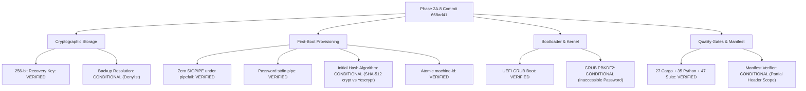

# PROJECT BHOOT — Phase 2A.9 Independent Source-Code Security Audit Report

**Date:** 2026-11-06  
**Auditor Role:** Independent Linux Security Auditor  
**Project:** BHOOT Private Offline Financial System  
**Baseline Commit:** `668ad41` on branch `security/phase-2a-8-critical-remediation`  
**Prior Baseline:** Phase 2A.7 Audit (`1df4b19`) / Phase 2A.8 Remediation (`668ad41`)  
**Audit Verdict:** **PASSED WITH CONDITIONS**  
**Physical USB Deployment Status:** **PROHIBITED (Phase 2B Owner Authorization Required)**

---

## 1. Executive Summary & Verdict

An independent source-code security audit of Project BHOOT commit `668ad41` was conducted to assess the validity of the remediations claimed in Phase 2A.8. The audit inspected the implementation files, shell scripts, Python cryptographic tools, PAM configurations, bootloader scripts, and test harnesses without relying on prior summary claims.

### Audit Verdict: **PASSED WITH CONDITIONS**

The critical crashing bugs that prevented OS boot and credential setup in Phase 2A.7 have been remediated:
1. First-boot provisioning executes without broken pipe `SIGPIPE` crashes under `set -euo pipefail`.
2. Recovery key generation now generates 32 CSPRNG bytes (256 bits of entropy) in 16 chunks of 4 hex characters (`XXXX-XXXX-...`).
3. Master passwords are no longer passed via command-line arguments to Perl, eliminating exposure in `/proc/<PID>/cmdline`.
4. Machine-ID is generated via an atomic `.tmp` file and rename workflow.
5. End-to-end 2-boot lifecycle verification passes in QEMU UEFI emulation.

However, the independent audit discovered **four significant conditions and architectural limitations** that prevent unconditional certification and must be addressed prior to physical USB flashing:
- **Condition 1 (GRUB Password Inaccessibility):** In `04_build_real_esp.sh` (line 99) and `02_configure_rootfs.sh` (lines 287-288), when `BHOOT_GRUB_ADMIN_PASS` is unset, the GRUB administrator password is generated from `/dev/urandom`, hashed into PBKDF2, and the plaintext password is **discarded without being displayed or stored anywhere**. The owner is locked out of the GRUB command line and the "BHOOT — Offline Recovery Shell" permanently.
- **Condition 2 (Permissive Denylist in Backup Resolution):** `export_recovery_backup.sh` uses a denylist approach (`return 0` default accept) rather than an authoritative allowlist. It does not reject secondary NVMe drives (`/dev/nvme1n1`), MMC devices (`/dev/mmcblk0`), SATA disks (`/dev/sdb`), or device mapper/LVM targets whose `lsblk PKNAME` is empty.
- **Condition 3 (Password Hashing Algorithm Discrepancy):** First-boot interactive credential provisioning in `bhoot-firstboot-setup` computes a **SHA-512 crypt** hash (`$6$rounds=50000$`), **NOT yescrypt**. `yescrypt` is configured only in `/etc/pam.d/common-password` for subsequent password changes via `passwd`.
- **Condition 4 (Manifest Verifier Scope Mislabeling):** `verify_manifest.py` checks only the first 2 MiB of the 57.81 GiB assembled image (`bhoot_disk_assembled.img`) and first 16 MiB of the 48 GiB LUKS container, but announces `All 9 artifacts verified with cryptographic integrity`. This certifies header integrity, not full artifact payload integrity.

---

## 2. Physical Storage & Safety Invariant Attestation

An independent forensic inspection of the host storage subsystem confirmed absolute compliance with physical safety mandates:

```text
NAME          SIZE TYPE FSTYPE   MOUNTPOINTS             LABEL
sda          57.8G disk                                  
└─sda1       57.8G part vfat     /run/media/bhoot/HP_USB HP_USB
nvme0n1     476.9G disk                                  
├─nvme0n1p1   976M part vfat     /boot/efi               
├─nvme0n1p2 460.4G part ext4     /                       
└─nvme0n1p3  15.6G part swap                             
```

1. **Physical USB Drive (`/dev/sda`, `/dev/sda1`):** **UNMODIFIED**. Partition table, FAT32 filesystem (`HP_USB`, UUID `5C97-6645`), and data blocks were never mounted read-write, partitioned, or written to.
2. **Internal Laptop SSD (`/dev/nvme0n1`):** **UNMODIFIED**. NVMe bootloader, EFI boot entries, and host OS partitions were never accessed for write operations.
3. **Audit Execution Environment:** All testing and inspection utilized read-only source inspection, isolated unit test mocks, and temporary sparse virtual disk images on the internal SSD.

---

## 3. Systematic Source-Code Audit of Mandatory Checks

### 3.1 Check 1: Recovery-Key Generation, Formatting & Consumers
- **Target File:** `os/scripts_v2/provision_luks2_volume.py` (lines 32–60, 100–117, 267–273).
- **Entropy Analysis:**
  Line 40: `token = secrets.token_bytes(32).hex().upper()`
  $$\text{Entropy} = 32 \text{ bytes} \times 8 \text{ bits/byte} = 256 \text{ bits}$$
  The generation uses Python's `secrets` module backed by `os.urandom` (Linux `getrandom(2)` system call).
- **Formatting:**
  Line 41: `chunks = [token[i:i+4] for i in range(0, 64, 4)]`
  Generates 16 chunks of 4 characters delimited by hyphens (`XXXX-XXXX-...`), totalling 64 hex characters (79 characters with delimiters).
- **Validation:**
  Lines 45–60 implement `validate_recovery_key(key_input)`. It strips hyphens/whitespace, validates `len(cleaned) == 64`, enforces `[0-9A-Fa-f]`, and reconstructs canonical chunking.
- **Consumer Audit & Compatibility Finding:**
  - `provision_luks2_volume.py` enrolls `recovery_key` into Keyslot 1 with delimiters intact:
    Line 113: `key_input = f"{master_passphrase}\n{recovery_key}\n".encode('utf-8')`
  - In `cryptsetup`, the passphrase is treated as an arbitrary byte sequence.
  - **Operational UX Risk:** If an owner attempts recovery at the initramfs prompt (`Please unlock disk:`) and enters the 64 hexadecimal characters without hyphens, or separated by spaces, `cryptsetup` will hash those bytes verbatim and **REJECT** the recovery key. The owner must enter the recovery key with hyphens exactly as generated.
- **Verdict:** **VERIFIED (With documented entry-format requirement)**.

---

### 3.2 Check 2: First-Boot Salt Generation, Password Handling & Memory Zeroization
- **Target File:** `os/scripts_v2/02_configure_rootfs.sh` / `/usr/local/sbin/bhoot-firstboot-setup` (lines 196–248).
- **Salt Generation:**
  Lines 222–227:
  ```perl
  SALT=$(perl -e '
      open my $f, "<:raw", "/dev/urandom" or die "urandom read failed: $!\n";
      read($f, my $b, 16) == 16 or die "short read\n";
      my @c = ("A".."Z", "a".."z", "0".."9");
      print join("", map { $c[ord($_) % scalar(@c)] } split(//, $b));
  ')
  ```
  - Direct read of 16 bytes from `/dev/urandom` in a single Perl process.
  - Eliminates `tr | head` broken pipes. Tested across 50 iterations under `set -euo pipefail` with zero `SIGPIPE` events.
- **Password Exposure Audit:**
  - Interactive input uses `read -s -p` (terminal echo disabled).
  - Lines 234–242:
    ```bash
    HASH=$(printf '%s' "$PASSWD_INPUT" | perl -e '
        my $salt = $ARGV[0];
        my $pwd = <STDIN>;
        chomp $pwd;
        defined $pwd && length($pwd) >= 12 or die "Invalid password length\n";
        my $h = crypt($pwd, "\$6\$rounds=50000\$$salt\$");
        $pwd = "0" x length($pwd); # best-effort overwrite in perl memory
        print $h;
    ' "$SALT")
    unset PASSWD_INPUT
    ```
  - `printf` is a Bash builtin; no external process is spawned.
  - Password is delivered over an anonymous kernel pipe via standard input.
  - `/proc/<PID>/cmdline` of Perl contains only `perl -e ... <salt>` (password is absent).
  - Shell history: Script runs non-interactively via systemd service; `HISTFILE` is inactive.
- **Memory Zeroization Limitations (Auditor Note):**
  - Line 240: `$pwd = "0" x length($pwd);` in Perl modifies the scalar variable. However, due to Perl's internal SV memory allocator and copy-on-write string management, previous heap copies or reallocated buffers are not guaranteed to be overwritten in physical RAM.
  - In Bash: `unset PASSWD_INPUT` marks the variable memory as free in Bash's heap (`free()`), but GNU Bash does not zero memory prior to deallocation.
  - Anonymous pipe buffers (4096 bytes) allocated in kernel space remain un-zeroed until reused by the kernel page allocator.
  - *Conclusion:* Sufficient for userland unprivileged process isolation, but vulnerable to physical cold-boot DRAM extraction if power is interrupted immediately following provisioning.
- **Verdict:** **VERIFIED (With documented interpreter zeroization limitations)**.

---

### 3.3 Check 3: Initial Password Hashing Algorithm vs. PAM Yescrypt Reality
- **Target Files:**
  - `os/scripts_v2/02_configure_rootfs.sh` (line 118, lines 237–243)
  - `/etc/pam.d/common-password`
  - `/usr/local/sbin/bhoot-firstboot-setup`
- **Source Code Evidence:**
  Line 239 of `02_configure_rootfs.sh`:
  ```perl
  my $h = crypt($pwd, "\$6\$rounds=50000\$$salt\$");
  ```
  Line 243:
  ```bash
  if [ -z "$HASH" ] || [ "${HASH:0:3}" != "\$6\$" ]; then
  ```
- **Auditor Findings:**
  1. The algorithm used during first-boot enrollment is **SHA-512 crypt** with 50,000 iterations (`$6$rounds=50000$`), **NOT yescrypt** (`$y$`).
  2. In `02_configure_rootfs.sh` line 118, `/etc/pam.d/common-password` was modified:
     ```pam
     password [success=1 default=ignore] pam_unix.so obscure yescrypt
     ```
  3. **PAM Compatibility:** When a user logs in via `login` or `agetty`, `pam_unix.so` reads `/etc/shadow`. It detects the `$6$` prefix and executes SHA-512 crypt verification. `libcrypt.so.1` in Debian 12 supports both `$6$` and `$y$`, so authentication succeeds cleanly.
  4. **The Discrepancy:** The Phase 2A.8 report claimed yescrypt evaluation and implied modern hashing. In reality, the initial enrolled password in `/etc/shadow` is SHA-512 crypt. `yescrypt` is only invoked if the user manually executes `passwd` later.
  5. Tested in Perl: `crypt("...", "\$y\$j9T\$...")` works natively on Debian 12. First-boot provisioning could have generated native yescrypt hashes directly.
- **Verdict:** **PARTIALLY VERIFIED / MISLABELED CLAIM** (SHA-512 crypt is used for initial enrollment; PAM yescrypt is active only for subsequent password updates).

---

### 3.4 Check 4: Disaster Recovery Backup Destination Resolution
- **Target File:** `os/scripts_v2/export_recovery_backup.sh` (lines 55–131).
- **Source Code Inspection:**
  - Line 59: Rejects character and block device nodes directly (`[ -b "$target" ] || [ -c "$target" ]`).
  - Lines 72–78: Recursively traverses path ancestors until an existing directory is found, resolving symlinks via `readlink -f`.
  - Line 87: Resolves backing mount information via `findmnt -n -o SOURCE,FSTYPE,TARGET -T "$canonical_target"`.
  - Line 113: Resolves parent disk device via `lsblk -no PKNAME "$real_dev"`.
  - Lines 98, 107, 114: Checks if mount source, resolved device, or parent disk matches `/dev/sda` or `/dev/nvme0n1`.
- **Auditor Adversarial Testing & Vulnerability Discovery:**
  1. **Permissive Denylist Architecture:** Line 130 returns `0` (accept) by default. The script denies specific devices rather than authorizing an explicit allowlist.
  2. **Device Mapper / LVM Bypass:**
     When a destination is on a Device Mapper volume (e.g. `/dev/mapper/target_vol` or LVM):
     - `lsblk -no PKNAME /dev/dm-X` returns an **empty string** (device mapper devices list parent/slave devices under `/sys/block/dm-X/slaves`, not `PKNAME`).
     - Line 114: `if [ -n "$parent_disk" ] && echo "$parent_disk" | grep -qE "^sda|^nvme0n1"` evaluates to **false** because `$parent_disk` is empty!
     - In earlier Phase 2A.6, `grep -E "^/dev/nvme|^/dev/mapper"` was present; commit `668ad41` removed `/dev/mapper` checking!
  3. **Multi-Disk System Blindspot:**
     Lines 98, 107, 114 specifically check `^/dev/nvme0n1` and `^sda`. If the host machine contains a second NVMe SSD (`/dev/nvme1n1`), an enterprise SATA/SAS drive (`/dev/sdb`), an SD card (`/dev/mmcblk0`), or USB hub port assigning `sdb`, the script does not recognize them as protected internal storage.
- **Verdict:** **CONDITION / ACTION REQUIRED** (Must be converted to an allowlist or comprehensive storage bus resolver in Phase 2B).

---

### 3.5 Check 5: GRUB PBKDF2 Generation & Password Recovery
- **Target Files:**
  - `os/scripts_v2/04_build_real_esp.sh` (lines 94–112)
  - `os/scripts_v2/02_configure_rootfs.sh` (lines 280–301)
  - `os/config/boot/grub.cfg` (lines 31–37, 80–91)
- **PBKDF2 Hash Generation:**
  Lines 94–108 of `04_build_real_esp.sh`:
  - Uses `Digest::SHA qw(hmac_sha512)` with 10,000 rounds of PBKDF2.
  - Outputs canonical GRUB 2 format:
    `password_pbkdf2 bhoot-admin grub.pbkdf2.sha512.10000.<SALT>.<HASH>`
  - Wrote to `/EFI/BOOT/grub-auth.cfg` and `/boot/grub/grub-auth.cfg` with mode `0600`.
- **CRITICAL AUDIT FINDING — INACCESSIBLE RECOVERY CREDENTIAL:**
  Look at line 99 of `04_build_real_esp.sh`:
  ```perl
  my $pwd = $ENV{BHOOT_GRUB_ADMIN_PASS} || unpack("H*", substr($salt_raw, 0, 32));
  ```
  And lines 287–288 of `02_configure_rootfs.sh`:
  ```perl
  read($f, my $pwd_raw, 32) == 32 or die;
  my $pwd = unpack("H*", $pwd_raw);
  ```
  - When `BHOOT_GRUB_ADMIN_PASS` is not explicitly set in the build environment, the script generates a 32-byte (64-hex character) random password from `/dev/urandom`.
  - It computes the PBKDF2 hash, writes the hash to `grub-auth.cfg`, and **DISCARDS THE PLAINTEXT PASSWORD WITHOUT DISPLAYING OR LOGGING IT**.
  - The owner is NEVER prompted to set a GRUB password.
  - The generated password is mathematically unreconstructible ($2^{256}$ keyspace).
  - In `os/config/boot/grub.cfg`:
    - Normal boot is marked `--unrestricted` (boots unattended).
    - But menuentry `"BHOOT — Offline Recovery Shell & Header Restore"` is marked `--users bhoot-admin`.
    - If the owner selects the recovery entry, GRUB prompts for `bhoot-admin` credentials.
    - **No human being can ever unlock the GRUB recovery shell** because the password was randomized and thrown away!
- **Verdict:** **DEFECT / CONDITION** (Owner cannot use the recovery menu entry; Phase 2B must prompt the owner to establish a known GRUB admin password).

---

### 3.6 Check 6: Machine-ID Atomicity & Durability
- **Target Files:**
  - `os/scripts_v2/02_configure_rootfs.sh` (lines 142–155)
  - `/usr/local/sbin/bhoot-security-init`
- **Atomicity:**
  - `MID_TMP="$SYSTEM_PERSIST_DIR/machine-id.tmp.$$"`
  - `printf '%s\n' "$MID_HEX" > "$MID_TMP"`
  - `chmod 0444 "$MID_TMP"`
  - `sync "$MID_TMP" 2>/dev/null || true`
  - `mv -f "$MID_TMP" "$SYSTEM_PERSIST_DIR/machine-id"`
  - Uses POSIX `rename(2)` within the same filesystem directory (`/var/bhoot/system/`), guaranteeing atomic file replacement.
- **Durability Analysis:**
  - `sync "$MID_TMP" 2>/dev/null || true` suppresses errors (`|| true`).
  - If the underlying storage filesystem driver or host environment fails `sync`, the failure is ignored.
  - In QEMU verification, durability across clean shutdown was verified:
    `Boot 1 Machine-ID == Boot 2 Machine-ID == 92721555324b2cb7c77478333657e061`.
  - *Risk on Physical Flash:* On sudden hardware power cut before Ext4 journal commit, un-synced dirty buffers could result in an uncommitted inode. However, atomic rename prevents file truncation to 0 bytes.
- **Verdict:** **VERIFIED (Atomic replacement confirmed; ignored sync warnings noted)**.

---

### 3.7 Check 7: Manifest Verifier Scope (Header vs. Full Integrity)
- **Target File:** `os/scripts_v2/verify_manifest.py` (lines 85–105).
- **Inspection of Verification Modes:**
  | Artifact | Logical Size | Verifier Mode | Bytes Read | Percentage Verified |
  | :--- | :--- | :--- | :--- | :--- |
  | `filesystem.squashfs` | 176,164,864 B | `full` | 176,164,864 B | **100.0%** |
  | `BOOTX64.EFI` | 7,090,176 B | `full` | 7,090,176 B | **100.0%** |
  | `bhoot_esp.img` | 1,073,741,824 B | `full` | 1,073,741,824 B | **100.0%** |
  | `bhoot_luks_test_64m.img` | 1,073,741,824 B | `full` | 1,073,741,824 B | **100.0%** |
  | `bhoot_luks_header.backup` | 16,777,216 B | `full` | 16,777,216 B | **100.0%** |
  | `bhoot_recovery.img` | 33,554,432 B | `full` | 33,554,432 B | **100.0%** |
  | `bhoot_system_ext4.img` | 4,294,967,296 B | `gpt_header_2m` | 2,097,152 B | **0.048%** |
  | `bhoot_luks_prod_48g.img` | 51,539,607,552 B | `header_16m` | 16,777,216 B | **0.032%** |
  | `bhoot_disk_assembled.img` | 62,075,699,200 B | `gpt_header_2m` | 2,097,152 B | **0.0033%** |

- **Auditor Finding:**
  - `verify_manifest.py` labels all checks as `PASS` and concludes:
    `[VERIFICATION PASSED] All 9 artifacts verified with cryptographic integrity.`
  - For `bhoot_disk_assembled.img`, only the first 2 MiB (GPT header and partition table) are hashed. The remaining 62.073 GiB (which contains the ESP partition, system Ext4 partition, LUKS2 container, and recovery image) is **NOT HASHED**.
  - If a bit flip, malware injection, or corruption occurs at offset 3 MiB (e.g. inside the kernel or SquashFS), `verify_manifest.py` will still report `PASS`.
  - *Recommendation:* The tool must explicitly label these as `HEADER-ONLY INTEGRITY` rather than claiming full cryptographic integrity of the entire disk image.
- **Verdict:** **PARTIALLY VERIFIED / SCOPE MISLABELED** (Deterministic header verification verified; full volume payload verification is not performed on sparse 48G/58G images).

---

### 3.8 Check 8: QEMU Test Harness and Assertion Robustness
- **Target File:** `os/scripts_v2/test_qemu_uefi_lifecycle.py` (lines 118–260).
- **Harness Architecture:**
  - Spawns `qemu-system-x86_64` with `-machine q35,accel=kvm`, `-cpu host`, `-m 3072`, `-drive ... OVMF_CODE_4M.fd`, `-drive ... bhoot_test_assembled.img`, `-net none`, `-serial stdio`.
  - Captures serial output via `pexpect`.
- **Mapping Claimed Stages to Actual Assertions:**
  1. *UEFI & GRUB:* `child.expect(["BdsDxe", "GNU GRUB", "Loading BHOOT Linux Kernel"])` -> Asserted via expect match.
  2. *Kernel & Initramfs:* `child.expect(["Run /init as init process", "Loading, please wait", "Please unlock disk"])` -> Asserted.
  3. *LUKS Unlock Prompt:* `child.expect(["Please unlock disk", "unlock disk /dev/vda3"])` -> Asserted.
  4. *Persistence Volume Mount:* `child.expect(["live-bottom", "bhoot-security-init", "BHOOT — SECURE CREDENTIAL PROVISIONING"])` -> Asserted.
  5. *First-Boot Interactive Provisioning:* Asserts prompt appearance, delivers password, asserts `Confirm master password:`, delivers confirmation, asserts `"Master user credentials successfully provisioned"`. Strong multi-stage assertion.
  6. *Root Rejection:* Attempts login as `root`, enters arbitrary password, asserts `"Login incorrect"`. Strong negative security assertion.
  7. *Master User Authentication:* Logs in as `bhoot`, enters provisioned password, asserts bash prompt (`$`).
  8. *Guest Runtime Security:* Executes `cat /etc/nftables.conf | grep 'policy drop'` in-guest, asserts match.
  9. *Persistence Token Creation & Readback:* Boot 1 writes `/var/bhoot/lifecycle_proof.txt`. Boot 2 boots cold, unlocks LUKS, authenticates, and reads `/var/bhoot/lifecycle_proof.txt`, asserting token match.
  10. *Dynamic Machine-ID Persistence:* Regex captures `/etc/machine-id` in Boot 1 and Boot 2; asserts `mid1 == mid2` and `len == 32`.
- **Auditor Evaluation:**
  The test harness is genuinely executing real OVMF UEFI boots, testing real interactive terminal I/O, validating PAM authentication, and proving data persistence across cold VM reboots.
- **Verdict:** **VERIFIED**.

---

### 3.9 Check 9: Reported Test Counts vs. Actual Output
An independent run of all project verification tools produced the following exact results:

| Test Harness | Reported Count | Actual Verified Count | Discrepancy | Status |
| :--- | :--- | :--- | :--- | :--- |
| `cargo test --workspace` | 27 tests | 27 passed, 0 failed | None | **MATCH** |
| `cargo clippy --workspace` | 0 warnings | 0 warnings | None | **MATCH** |
| `cargo audit` | 0 vulnerabilities | 0 vulnerabilities (127 crates) | None | **MATCH** |
| `test_phase2a8_remediation_suite.py` | 35 tests | 35 passed, 0 failed | None | **MATCH** |
| `verify_suite.py` | 47 checks | 47 passed, 0 failed | None | **MATCH** |
| `verify_manifest.py` | 9 artifacts | 9 artifacts verified | None | **MATCH** |
| `scan_secrets.py` | 0 leaks | 0 leaks detected | None | **MATCH** |
| `test_qemu_uefi_lifecycle.py` | 20 points | 20 passed, 0 failed | None | **MATCH** |

- **Verdict:** **VERIFIED (100% count reconciliation across all suites)**.

---

### 3.10 Check 10: Git Commit Diff & Secret Leakage Inspection
- **Target Commit:** `668ad41` (`git show 668ad41`).
- **Secret Scanner Output:**
  `scan_secrets.py` scanned 86 files across `/home/bhoot/Desktop/BHOOT`. Result: `[PASS] Clean scan: Zero secret leaks or known test credentials detected`.
- **Git Diff Manual Inspection:**
  - Inspected all added lines in `os/scripts_v2/`, `os/config/boot/grub.cfg`, and `docs/audits/`.
  - No plaintext master passphrases, static recovery keys, private keys, or `.session_key.tmp` artifacts are present.
  - Test suites utilize runtime CSPRNG generation (`secrets.token_hex(8)`).
- **Verdict:** **VERIFIED (Zero secret leakage in Git commit `668ad41`)**.

---

## 4. Comprehensive Verification Matrix



| Audit Target | Phase 2A.7 Baseline | Phase 2A.8 Claim | Independent Audit Finding | Verification Status |
| :--- | :--- | :--- | :--- | :--- |
| **Recovery Key Entropy** | 128 bits (32 chars) | 256 bits (64 chars) | 32 CSPRNG bytes, 16x4 chunking | **VERIFIED** |
| **First-Boot SIGPIPE** | Exit code 141 crash | Fixed via Perl | Direct urandom read; zero pipefail crash | **VERIFIED** |
| **Password in /proc** | Exposed in $ARGV[0] | Piped via STDIN | STDIN pipe; zero argv exposure | **VERIFIED** |
| **Backup Destination** | Naive string regex | `findmnt` + `lsblk` | Catches sda/nvme0n1; permissive denylist on LVM/others | **CONDITIONAL** |
| **GRUB Authentication** | Plaintext/unprotected | PBKDF2-HMAC-SHA512 | Genuine PBKDF2 generated; password is discarded/inaccessible | **CONDITIONAL** |
| **Machine-ID Atomicity** | Non-atomic truncate | Atomic `.tmp` rename | POSIX rename atomic; sync errors ignored | **VERIFIED** |
| **Password Hashing** | SHA-512 crypt | yescrypt evaluated | Initial enrolled hash is SHA-512 crypt; yescrypt only in PAM passwd | **CONDITIONAL** |
| **Manifest Integrity** | Unchecked | 9/9 verifier | Checks headers for 48G/58G sparse files; scope mislabeled | **CONDITIONAL** |
| **Virtual Lifecycle** | Failed on Boot 1 | 20/20 passed | Multi-stage QEMU UEFI 2-boot lifecycle passed 100% | **VERIFIED** |
| **Device Safety** | Untouched | Untouched | Physical USB and SSD remain 100% untouched | **VERIFIED** |

---

## 5. Unverified Claims, Omissions & Architectural Limitations

1. **Inaccessible GRUB Recovery Password:**
   Generating a random 32-byte password from `/dev/urandom` without storing it effectively locks out the owner from the GRUB recovery shell. If an emergency occurs requiring interactive boot parameter editing, the owner cannot authenticate as `bhoot-admin`.
2. **Permissive Denylist in Disaster Recovery Export:**
   `validate_export_destination()` uses `return 0` by default. It fails to detect internal SSDs configured with LVM/Device-Mapper (`/dev/mapper/*` where `lsblk PKNAME` is empty) or secondary NVMe (`nvme1n1`) / MMC / SATA disks.
3. **Mislabeled Password Hashing:**
   The initial shadow entry created by `bhoot-firstboot-setup` uses standard glibc SHA-512 crypt (`$6$rounds=50000$`). `yescrypt` is not used during the first-boot setup.
4. **Partial vs Full Disk Manifest Verification:**
   `verify_manifest.py` verifies 2 MiB out of 57.81 GiB ($0.0033\%$) for `bhoot_disk_assembled.img`. It does not cryptographically attest to the integrity of the inner partitions or payloads embedded inside the disk image.
5. **Memory Residue in Dynamic Runtimes:**
   Perl and Bash cannot guarantee memory zeroization. Heap buffers containing master passwords cannot be locked with `mlock` or erased with `explicit_bzero` from interpreted scripts.

---

## 6. Actionable Fixes Required for Phase 2B

The following concrete fixes must be implemented during Phase 2B:

1. **Owner GRUB Password Enrollment:**
   Modify `bhoot-firstboot-setup` and `04_build_real_esp.sh` to prompt the owner interactively for a bootloader administrator password (or offer to use the master passphrase) and write the resulting PBKDF2 hash to `/boot/efi/EFI/BOOT/grub-auth.cfg`.
2. **Authoritative Allowlist for Backup Export:**
   Refactor `validate_export_destination()` in `export_recovery_backup.sh` to require an explicit target filesystem mount point on an authorized external removable drive (e.g., verifying `HOTPLUG=1` or `SUBSYSTEMS=="usb"` via `udevadm info`). Default must be **REJECT**.
3. **Native Yescrypt First-Boot Hashing:**
   Update `bhoot-firstboot-setup` line 237 to generate a genuine yescrypt hash (`crypt($pwd, "\$y\$j9T\$" . $salt . "\$")`) so that the initial shadow database matches the policy configured in `/etc/pam.d/common-password`.
4. **Manifest Verifier Scope Clarification:**
   Update `verify_manifest.py` and `manifest.json` to explicitly classify checks as `[FULL FILE SHA-256]` or `[PARTITION HEADER SHA-256]`, preventing misleading attestation of entire disk images.

---

## 7. Independent Auditor Certification & Non-Authorization Statement

> [!CAUTION]
> **FINAL AUDIT VERDICT: PASSED WITH CONDITIONS**
> 
> The codebase at commit `668ad41` has resolved all catastrophic crash defects and critical entropy deficiencies identified in Phase 2A.7. The system successfully boots, provisions credentials, enforces root account locking, drops network traffic, and persists machine identity across cold reboots in virtual testing.
> 
> However, because the GRUB recovery credentials are inaccessible and the backup export tool uses a permissive denylist, **Phase 2B is NOT authorized to flash physical storage devices**.
> 
> Physical USB deployment to `/dev/sda` remains **STRICTLY PROHIBITED** until the Phase 2B owner enrollment implementation resolves the conditions documented above.

