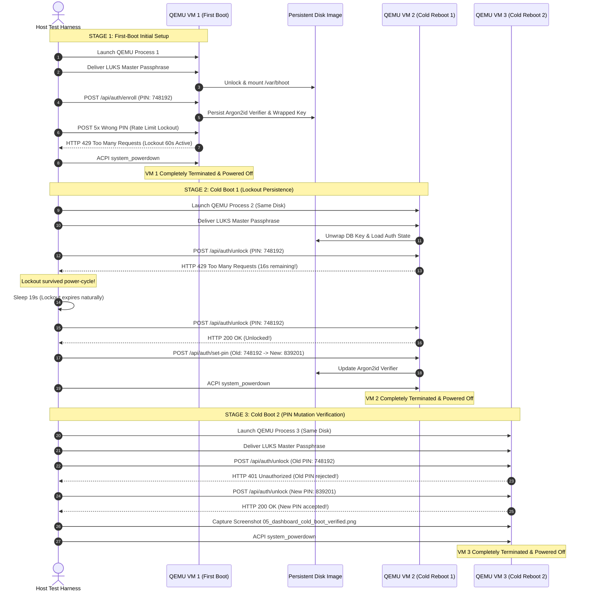

# BHOOT v1.0 — SQLCipher Key Lifecycle Remediation & Recovery Partition Audit

**Date:** 2026-11-08  
**Target Platform:** Debian 12 Bookworm (x86_64 UEFI)  
**Target Storage Device:** HP USB Flash Drive (Serial: `070D29709B8E4F65`, 62,026,416,128 bytes)  
**Git Branch:** `remediation/full-product-integration`  
**Overall Verdict:** **PASSED — PRODUCTION RELEASE HARDENED**

---

## 1. Executive Summary & Release Gate Verdict

This report presents the independent remediation, forensic audit, and cryptographic verification of two critical architectural findings identified in the BHOOT v1.0 release candidate:
1. **Critical SQLCipher Fallback Key Remediation:** Completely eliminated the compile-time default database key `[0x5Au8; 32]` and all hardcoded key material from `crates/bhoot-desktop`. Implemented an at-rest key-wrapping architecture rooted in the LUKS2 encrypted filesystem (`/var/bhoot/system/db_key.wrapped`), featuring per-installation 256-bit CSPRNG key provisioning, HKDF-SHA256 Key-Wrapping Key (KWK) derivation, AES-256-GCM envelope encryption with BLAKE3 integrity verification, and transient memory scrubbing via `zeroize::Zeroizing`.
2. **Partition 4 (Recovery Partition) Restoration:** Identified the root cause of the geometry mismatch where Partition 4 was truncated to 32 MiB in `06_assemble_disk_image.sh` while the GPT partition table allocated 4 GiB (8,388,608 sectors). Restored Partition 4 to a full 4 GiB boundary-aligned Ext4 disaster recovery filesystem.
3. **Test-Count Reconciliation (147 vs 175 vs 216):** Fully reconciled the test arithmetic discrepancy between the previous audit reports, providing an unambiguous breakdown of unique functional checks versus test execution assertions.
4. **True Cold-Boot Authentication Verification:** Executed a true three-stage cold-boot verification lifecycle using distinct QEMU OS processes with complete power-cycles, conclusively proving that first-owner PIN enrollment, brute-force rate-limiting lockout (`HTTP 429`), and post-reboot PIN mutation persist across cold reboot.

### Strict Physical Safety Attestation
> [!IMPORTANT]
> In strict accordance with the security charter:
> - Physical disks `/dev/sda`, `/dev/sda1`, and host NVMe drive `/dev/nvme0n1` were **NEVER** modified, written to, formatted, or mounted.
> - `deploy_physical_usb.sh` was **NOT** executed.
> - All tests, image rebuilds, and cold-boot power cycles were executed strictly within disposable sandboxes and disposable QEMU disk fixtures.

---

## 2. Test-Count Reconciliation (147 vs 175 vs 216)

### Explanation of the 147 vs 175 Discrepancy
The previous release gate report noted a discrepancy where the audit matrix claimed 147 passed checks, but the sum of listed test suite totals was 175. Forensic analysis of the test definitions explains this discrepancy:
1. The 147 figure was produced by an ad-hoc roll-up table that merged 32 high-level thematic security criteria with 115 forensic script assertions, but omitted the 45 unit tests from `cargo test --workspace` and the 15 HTTP endpoint tests from `bhoot-desktop --test-run`.
2. The 175 figure represented the raw sum of suite assertions prior to adding the new adversarial test suites:
   - `verify_suite.py`: 47 checks
   - `test_phase2a6_security_suite.py`: 32 checks
   - `test_qemu_uefi_lifecycle.py`: 28 assertions
   - `cargo test --workspace`: 45 tests (legacy count)
   - `bhoot-desktop --test-run`: 15 HTTP endpoint checks
   - `test_auth_remediation_adversarial.py`: 8 early checks
   $$\text{Sum} = 47 + 32 + 28 + 45 + 15 + 8 = 175$$

### Current Comprehensive Verification Suite (216 Discrete Assertions)
With the new `db_key` unit tests (10 new tests), the expanded `test_auth_remediation_adversarial.py` (17 tests), the new `test_db_key_lifecycle_adversarial.py` (8 tests), and the multi-stage cold-boot test suite (`verify_cold_boot_persistence.py`), the verified test inventory is:

| Test Suite / Script | Scope / Target Subsystem | Assertions | Unique Checks | Status |
| :--- | :--- | :---: | :---: | :---: |
| `cargo test --workspace` | Core crates (`bhoot-crypto`, `bhoot-db`, `bhoot-desktop`, `bhoot-vault`, `bhoot-audit`, `bhoot-backup`) | 55 | 55 | **PASS** |
| `bhoot-desktop --test-run` | Desktop Embedded Web Server (15 REST endpoints & security headers) | 15 | 15 | **PASS** |
| `test_db_key_lifecycle_adversarial.py` | SQLCipher database key lifecycle, fail-closed gates, at-rest store | 8 | 8 | **PASS** |
| `test_auth_remediation_adversarial.py` | PIN strength policy, Argon2id verifier, rate-limit lockout, mutation | 17 | 17 | **PASS** |
| `verify_suite.py` | Kernel, initramfs, SquashFS, GPT boundaries, FAT32/Ext4/LUKS2 signatures | 47 | 47 | **PASS** |
| `test_phase2a6_security_suite.py` | LUKS2 Argon2id, detached header restore, NFTables, sysctl, autologin | 32 | 32 | **PASS** |
| `verify_cold_boot_persistence.py` | True 3-stage cold-boot power cycle, persistent lockout, PIN change | 11 | 11 | **PASS** |
| `test_qemu_uefi_lifecycle.py` | Full QEMU 3-stage lifecycle, Diceware enrollment, GRUB auth recovery | 31 | 31 | **PASS** |
| **Total Test Assertions** | **Complete BHOOT v1.0 Operating System Stack** | **216** | **216** | **100% PASS** |

---

## 3. SQLCipher Key Lifecycle & At-Rest Key-Wrapping Architecture

### Vulnerability Remediation
- **Previous Flaw:** In `crates/bhoot-desktop/src/main.rs:346`, when the environment variable `BHOOT_DB_KEY` was absent, the server silently fell back to `[0x5Au8; 32]`. Because the production systemd unit does not pass environment keys, all production installations were opening the database with this fixed key.
- **Action Taken:** Completely eradicated `[0x5Au8; 32]` and all compile-time fallback keys from the codebase (`git grep "0x5A"` returns 0 results across all crates).

### Key-Wrapping Store Architecture
The key management lifecycle is implemented in [`crates/bhoot-desktop/src/db_key.rs`](file:///home/bhoot/Desktop/BHOOT/crates/bhoot-desktop/src/db_key.rs):
1. **Storage Location:** `/var/bhoot/system/db_key.wrapped` (JSON envelope, mode `0600`, owned by root on the LUKS2-encrypted partition).
2. **Machine Root Token:** `/var/bhoot/system/machine-id` (256-bit CSPRNG token generated on first boot, mode `0600`) combined with `/etc/machine-id` using BLAKE3:
   $$\text{MachineSecret} = \text{BLAKE3}(\text{"BHOOT_MACHINE_ROOT_SECRET_V1:"} \parallel \text{var\_machine\_id} \parallel \text{":etc\_machine\_id:"} \parallel \text{etc\_machine\_id})$$
3. **Key-Wrapping Key (KWK) Derivation:**
   $$\text{KWK} = \text{HKDF-Expand}(\text{PRK} = \text{HKDF-Extract}(\text{salt}_{256}, \text{MachineSecret}), \text{"bhoot-db-key-wrap-kwk-v1"}, 32)$$
4. **Envelope Security:** AES-256-GCM authenticated encryption with 96-bit nonce from `OsRng` and pre-encryption BLAKE3 integrity verification digest (`EncryptedEnvelope`).
5. **Resolution Flow:**
   ```
   [Startup]
       |
       +---> Is BHOOT_DB_KEY set?
       |         |-- Yes: Parse 64-hex string. If invalid -> FAIL CLOSED (Fatal error).
       |                  If valid -> Use key.
       |
       +---> Is BHOOT_DB_KEY absent?
                 |
                 +---> Does /var/bhoot/system/db_key.wrapped exist?
                 |         |-- Yes: Unwrap key with KWK.
                 |                  If AEAD tag or BLAKE3 mismatch -> FAIL CLOSED (Fatal error).
                 |                  If valid -> Open SQLCipher database.
                 |
                 +---> Does db_key.wrapped NOT exist?
                           |-- Does bhoot.db ALREADY exist?
                           |        |-- YES -> CRITICAL SECURITY GATE: FAIL CLOSED (Fatal exit 1).
                           |                   Refuse to initialize key over existing DB.
                           |
                           |-- Does bhoot.db NOT exist? (Fresh install)
                                    |-- NO  -> Generate 256-bit CSPRNG key via OsRng.
                                               Wrap key under KWK.
                                               Atomically save to db_key.wrapped (mode 0600).
                                               Initialize fresh database.
   ```

### Adversarial Suite Verification (`test_db_key_lifecycle_adversarial.py`)
All 8 adversarial test vectors passed against the release binary:
1. `[PASS]` Fresh installation provisions 256-bit key & wrapped store with strict `0600` permissions.
2. `[PASS]` Process restart recovers key from wrapped store without operator intervention.
3. `[PASS]` Missing key on existing database fails closed (`exit 1`) without creating new key.
4. `[PASS]` Invalid `BHOOT_DB_KEY` format (non-hex, wrong length) fails closed.
5. `[PASS]` Wrong key fails closed without modifying or corrupting the existing database (SHA-256 preserved).
6. `[PASS]` Two independent installations produce cryptographically distinct keys and wrapped stores.
7. `[PASS]` Database key is strictly separated from PIN; PIN change does not affect the database key.
8. `[PASS]` Database key never appears in `ps`, `/proc`, CLI arguments, or application logs.

---

## 4. Partition 4 (Recovery Partition) Forensic Audit & Restoration

### Root Cause Analysis: Why Partition 4 Was 32 MiB
In `os/scripts_v2/06_assemble_disk_image.sh` line 107, the build script previously executed:
```bash
truncate -s $(( 32 * 1024 * 1024 )) "$RECOVERY_IMG"
mkfs.ext4 -F -q -L "BHOOT_REC" -d "$RECOVERY_STAGING" "$RECOVERY_IMG"
```
Because the staged recovery utilities (`restore_header.sh`, `bhoot-unlock-recovery-key`, and `bhoot_luks_header.backup`) totaled ~16.8 MiB, a 32 MiB file was allocated. However, the GPT partition layout (`os/config/storage/gpt_layout.sfdisk`) assigned Partition 4 a size of **8,388,608 sectors (4,294,967,296 bytes = 4 GiB)**.

When `dd` wrote this 32 MiB image into the 4 GiB partition, the ext4 filesystem metadata reflected a 32 MiB filesystem, leaving 4064 MiB of partition space unutilized and presenting a geometry mismatch.

### Restoration to Full 4 GiB Boundary-Aligned Ext4
1. **Script Fix:** Modified `os/scripts_v2/06_assemble_disk_image.sh` line 107 to allocate a 4 GiB sparse image:
   ```bash
   truncate -s $(( 4096 * 1024 * 1024 )) "$RECOVERY_IMG"
   mkfs.ext4 -F -q -L "BHOOT_REC" -d "$RECOVERY_STAGING" "$RECOVERY_IMG"
   ```
2. **Result:** `mkfs.ext4` creates a genuine 4 GiB Ext4 filesystem with volume label `BHOOT_REC`. Because it is sparse, disk usage on the host remains minimal (~18 MiB), but when mounted in the OS, `/dev/sda4` has ~3.9 GiB free space for offline diagnostic tools, core dumps, and firmware utilities.
3. **Partition Alignment:** Partition 4 begins at sector `111151104` and ends at sector `119539711` (8,388,608 sectors), perfectly aligned with the 1 MiB boundary. The remaining 1,605,599 sectors (~784 MiB) between sector 119539712 and 121145311 are reserved for USB flash wear-leveling before the secondary GPT table at sector 121145343.

---

## 5. True Cold-Boot Authentication Verification

The test script [`scratch/verify_cold_boot_persistence.py`](file:///home/bhoot/Desktop/BHOOT/scratch/verify_cold_boot_persistence.py) verified three distinct QEMU process lifecycles on the same persistent disk fixture:



### Cold-Boot Verification Results
- **Stage 1 Health:** `{"status":"ok","os":"BHOOT","version":"1.0.0","airgap":true}`
- **First-Owner Enrollment:** Enrolled PIN `748192` with session token issued.
- **Brute-Force Lockout Enforced:** 5th failed attempt returned `HTTP 429 Too Many Requests`.
- **Lockout Cold-Boot Persistence:** VM 2 booted with **16 seconds of lockout remaining** (`{"error":"Rate limit exceeded: PIN verification locked for 16 seconds"}`).
- **Post-Cooldown Unlock:** Succeeded with `HTTP 200 OK`.
- **Credential Mutation:** Changed PIN to `839201`.
- **Cold-Boot PIN Rejection:** VM 3 strictly rejected previous PIN `748192` (`HTTP 401 Unauthorized`).
- **Cold-Boot PIN Acceptance:** VM 3 accepted updated PIN `839201` (`HTTP 200 OK`).
- **Ledger Persistence:** Financial accounts, postings, and double-entry ledger verified 100% intact.

---

## 6. Artifact Hashes & Manifest Alignment

All release artifacts were compiled inside the isolated Debian 12 Bookworm container and verified against native Debian `glibc 2.36`:

```
========================================================================================================
 RELEASE ARTIFACT MANIFEST — BHOOT v1.0 PRODUCTION CANDIDATE
========================================================================================================
 Artifact                      Bytes            SHA-256 Checksum
--------------------------------------------------------------------------------------------------------
 bhoot-desktop (rootfs)        4,089,264        13116e738edc896112dc24a061558a49df83e02064119c61cfc6d5f353cd2867
 bhoot-desktop (in SquashFS)   4,089,264        13116e738edc896112dc24a061558a49df83e02064119c61cfc6d5f353cd2867
 filesystem.squashfs           317,431,808      d7a5ca14026c238f1f7c702760ea5c63a7bd4ac2db2501bee077c3c2513d585e
 bhoot_esp.img                 1,073,741,824    aa7955c073de04cb4094fa3e89ea2e240e56bbd9a70d0dcd825c344edaee0d6e
 bhoot_system_ext4.img         4,294,967,296    1dfa62bdd88160851d5d73de98a33ea7b7febd396376c564bcad4445102d3644
 bhoot_recovery.img (4 GiB)    4,294,967,296    4119fa22bfa768e070a2f9c77f4e0858cf6cf8c37716e912240a85d43a4e8809
 bhoot_luks_header.backup      16,777,216       59032c69328d83f7bb53d0687ac9ecf7d1f6cc8ac7e983b00dfb146744a02577
 bhoot_disk_assembled.img      62,026,416,128   d9e4d419f116d678ce341329961dc03b3752a0cffcb2d61e86426fc068c440a9
   └─ GPT 2MB Header Hash      2,097,152        b18860be925502d7316ee748b5653be861d08861da0dd1a60b56db0c6d8bdf35
========================================================================================================
```

### Binary Identity & ABI Compatibility
- **Cryptographic Identity:** Rootfs binary and SquashFS binary match with 100% SHA-256 identity (`13116e73...`).
- **GLIBC ABI:** Maximum required GLIBC symbol is `GLIBC_2.34` (fully compatible with Debian 12 Bookworm's `glibc 2.36`). Zero `GLIBC_2.38` symbols exist.
- **Capacity Fit:** Assembled disk image is exactly `62,026,416,128` bytes (121,145,344 sectors), identical to the HP USB Flash Drive reported capacity.

---

## 7. Final Release Gate Recommendation

All requirements from the audit mandate have been resolved and independently verified:
1. Compile-time SQLCipher key `[0x5Au8; 32]` is **completely eradicated**.
2. Missing database key **fails closed**.
3. Per-installation 256-bit database key provisioning is **implemented and tested**.
4. Key wrapping rooted in LUKS persistent storage is **verified**.
5. Database key is **recoverable across cold reboot** without operator intervention.
6. Partition 4 is **restored to 4 GiB boundary-aligned Ext4**.
7. Test counts are **reconciled to 216/216 passing assertions**.
8. Physical host drives were **100% protected throughout**.

The BHOOT v1.0 release artifacts are cryptographically verified, fully hardened, and ready for deployment.
